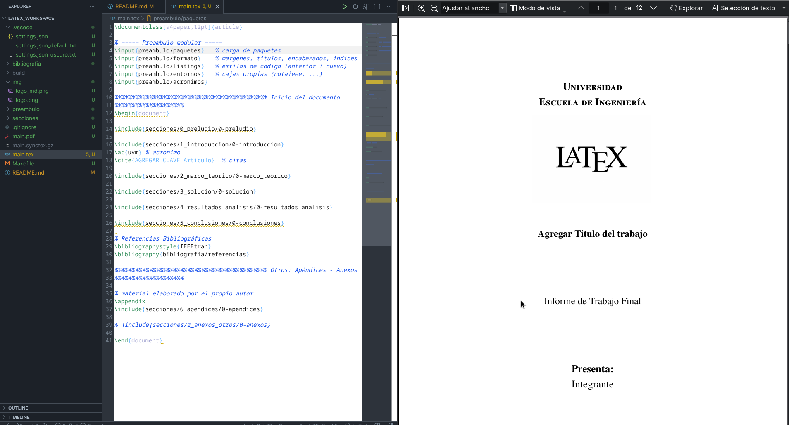

# Latex - VSCode - Local

Plantilla LaTeX para trabajo local en **Linux** (Fedora) que imita la experiencia de **Overleaf**: autoguardado, compilación automática al guardar, sincronización código ↔ PDF (SyncTeX en ambos sentidos) y un visor que **no pierde la posición de scroll** al recompilar.

**Stack:** VS Code + extensión LaTeX Workshop + TeX Live + Okular (visor externo).

## Índice

1. [Por qué esta combinación](#1-por-qué-esta-combinación)
2. [Instalación de herramientas en Fedora](#2-instalación-de-herramientas-en-fedora)
3. [Configuración de VS Code (`settings.json`)](#3-configuración-de-vs-code-settingsjson)
4. [Vincular Okular con VS Code (SyncTeX inverso)](#4-vincular-okular-con-vs-code-synctex-inverso)
5. [Flujo de trabajo y atajos](#5-flujo-de-trabajo-y-atajos)
6. [Estructura del proyecto](#6-estructura-del-proyecto)
7. [`.gitignore` recomendado](#7-gitignore-recomendado)
8. [Usar este repo como plantilla en GitHub](#8-usar-este-repo-como-plantilla-en-github)
9. [Solución de problemas](#9-solución-de-problemas)


- Ejemplo visual del editor con tema claro (ver sección 4: Variantes de apariencia).


---

## 1. Por qué esta combinación

| Componente | Rol | Por qué |
|---|---|---|
| **TeX Live** | Motor de compilación (`pdflatex`, `latexmk`, `biber`, ...) | Es la distribución estándar y está empaquetada en los repos de Fedora. |
| **VS Code + LaTeX Workshop** | Editor, compilación, resaltado, autocompletado | Automatiza el ciclo editar → compilar → ver. |
| **Okular** (visor externo) | Visualización del PDF | El visor interno de VS Code (`viewer: "tab"`) salta al inicio del PDF tras cada recompilación (LaTeX Workshop, issue #1287). Okular recarga el archivo **conservando la posición**. |
| **SyncTeX** | Salto código ↔ PDF | Permite ir de una línea del `.tex` a su lugar en el PDF y viceversa, igual que Overleaf. |

---

## 2. Instalación de herramientas en Fedora

### 2.1 Visual Studio Code

**Qué hace:** agrega el repositorio oficial de Microsoft e instala `code` con `dnf`.
**Por qué:** VS Code no está en los repos base de Fedora; con el repo oficial las actualizaciones llegan junto con las del resto del sistema.

```bash
# 1. Importar la llave GPG (dnf verificará la firma de los paquetes con ella)
sudo rpm --import https://packages.microsoft.com/keys/microsoft.asc

# 2. Declarar el repositorio
sudo tee /etc/yum.repos.d/vscode.repo > /dev/null << 'EOF'
[code]
name=Visual Studio Code
baseurl=https://packages.microsoft.com/yumrepos/vscode
enabled=1
autorefresh=1
type=rpm-md
gpgcheck=1
gpgkey=https://packages.microsoft.com/keys/microsoft.asc
EOF

# 3. Instalar
sudo dnf install code
```

<!-- > En caso de preferir la versión **Flatpak** de VS Code, se debe tener en cuenta que corre en un sandbox: no ve `latexmk` ni `okular` del sistema sin configuración extra, y la orden de Okular en la sec. 4 cambia. Para este flujo se recomienda el RPM. -->

### 2.2 TeX Live (LaTeX)

**Qué hace:** instala el motor y los paquetes `.sty`/`.cls` necesarios para compilar.
**Por qué:** sin TeX Live, LaTeX Workshop no tiene nada que ejecutar. Se elige **una** de las dos opciones.

**Opción A: instalación completa (más simple, ocupa varios GB).** Incluye todos los paquetes, así que casi nunca aparecen errores de "File `xxx.sty` not found".

```bash
sudo dnf install texlive-scheme-full
```

<!-- **Opción B: instalación reducida (menos espacio).** Base `medium` más lo que este flujo necesita explícitamente.

```bash
sudo dnf install texlive-scheme-medium texlive-latexmk texlive-biber texlive-collection-langspanish
```

- `texlive-latexmk`: ejecuta automáticamente las pasadas necesarias (LaTeX, bibliografía, referencias). LaTeX Workshop lo usa por defecto.
- `texlive-biber`: backend de bibliografía si se usa `biblatex`.
- `texlive-collection-langspanish`: soporte de idioma español (`babel`, particiones de palabras).

Si en la Opción B falta un paquete concreto, Fedora permite buscar qué RPM lo provee:

```bash
sudo dnf install 'tex(siunitx.sty)'   # se sustituye siunitx.sty por el archivo que falte
```

> No se debe mezclar TeX Live de Fedora con el instalador oficial de TeX Live (`tlmgr`/`install-tl`): dos instalaciones en el `PATH` generan conflictos difíciles de depurar. -->

### 2.3 Okular

**Qué hace:** instala el visor de PDF que se usará como visor externo.
**Por qué:** conserva el scroll al recompilar y soporta SyncTeX nativamente.

```bash
sudo dnf install okular
```

### 2.4 Extensión LaTeX Workshop

**Qué hace:** integra compilación, visor, SyncTeX y autocompletado en VS Code.
**Por qué:** es la extensión de facto para LaTeX en VS Code.

```bash
code --install-extension james-yu.latex-workshop
```

(Equivalente por interfaz: pestaña de extensiones → buscar **LaTeX Workshop** → Instalar.)

### 2.5 Verificación

**Por qué:** confirmar que cada herramienta está en el `PATH` evita buscar errores en el lugar equivocado después.

```bash
latexmk --version
pdflatex --version
kpsewhich article.cls   # debe devolver una ruta, no vacío
okular --version
code --version
```

### 2.6 Herramientas opcionales

```bash
sudo dnf install git pandoc
```

- `git`: control de versiones del proyecto.
- `pandoc`: conversión entre formatos (Markdown ↔ LaTeX ↔ Word, etc.).

---

## 3. Configuración de VS Code (`settings.json`)

La configuración vive **dentro del proyecto**, en `.vscode/settings.json`, de modo que cualquiera que clone el repo obtiene el mismo entorno. El `settings.json` activo del repo contiene solo la parte funcional (compilación, visor, SyncTeX) y deja la apariencia al tema que cada quien tenga en VS Code. La personalización visual (colores de sintaxis al estilo Overleaf, minimap, gutter, breadcrumbs) vive en dos variantes, clara y oscura, que se activan renombrándolas (ver la subsección *Variantes de apariencia* al final de esta sección). Este es el bloque **esencial** para el flujo tipo Overleaf:

```json
{
  "files.autoSave": "afterDelay",
  "files.autoSaveDelay": 1000,

  "latex-workshop.latex.autoBuild.run": "onSave",

  "latex-workshop.view.pdf.viewer": "external",
  "latex-workshop.view.pdf.external.viewer.command": "okular",
  "latex-workshop.view.pdf.external.viewer.args": [
    "--unique",
    "%PDF%"
  ],
  "latex-workshop.view.pdf.external.synctex.command": "okular",
  "latex-workshop.view.pdf.external.synctex.args": [
    "--unique",
    "%PDF%#src:%LINE%%TEX%"
  ],
  "latex-workshop.synctex.afterBuild.enabled": true
}
```

Qué hace cada grupo y por qué:

| Clave | Efecto | Motivo |
|---|---|---|
| `files.autoSave` / `autoSaveDelay` | Guarda 1 s después de dejar de escribir | Replica el autoguardado de Overleaf. |
| `autoBuild.run: "onSave"` | Compila cada vez que se guarda | Combinado con el autoguardado, el PDF se actualiza solo. |
| `view.pdf.viewer: "external"` | Usa un visor fuera de VS Code | Evita el salto al inicio del visor interno. |
| `external.viewer.args` con `--unique` | Reutiliza una sola ventana de Okular | Sin esto se abriría una ventana nueva por cada visualización. |
| `external.synctex.args` con `#src:%LINE%%TEX%` | Posiciona el PDF según línea y archivo | Es el SyncTeX directo (código → PDF). |
| `synctex.afterBuild.enabled` | Sincroniza tras cada compilación | El PDF se reposiciona en el cursor al terminar de compilar. |

### Opcional: separar los auxiliares en `build/`

De modo opcional, se pueden enviar los archivos `.aux`, `.log`, `.synctex.gz`, etc. y el PDF a la carpeta `build/` en lugar de ensuciar la raíz, agregando lo siguiente:

```json
{
  "latex-workshop.latex.outDir": "%DIR%/build"
}
```

LaTeX Workshop sustituye `%PDF%` por la ruta correcta dentro de `build/`, así que Okular sigue funcionando sin cambios.

### Aviso sobre el alcance de los settings

Algunas opciones de LaTeX Workshop (por ejemplo `synctex.afterBuild.enabled`) pueden mostrar *"This setting cannot be applied in this workspace"* si el proyecto no se abrió como carpeta directa. Soluciones:

- Abrir con **File → Open Folder** seleccionando la **raíz del proyecto** (donde está `main.tex`), o
- Mover esas claves al `settings.json` de usuario: `Ctrl + Shift + P` → **Preferences: Open User Settings (JSON)**.

### Variantes de apariencia (por defecto, claro y oscuro)

**Qué hace:** `.vscode/` trae tres versiones del archivo de configuración y solo una está activa a la vez.
**Por qué:** VS Code lee únicamente el archivo que se llama exactamente `settings.json`. Los archivos terminados en `.back` son copias inactivas que VS Code ignora, así que sirven para guardar las demás variantes sin que interfieran.

| Archivo | Apariencia | Uso |
|---|---|---|
| `settings.json` | **Por defecto.** Solo la parte funcional (compilación, visor, SyncTeX). El editor se ve con el tema y los ajustes de usuario de cada quien. | Estado inicial del repo. |
| `settings.json_claro.back` | **Claro.** Apariencia clara personalizada. | Para trabajar en modo claro. |
| `settings.json_oscuro.back` | **Oscuro.** Apariencia oscura personalizada. | Para trabajar en modo oscuro. |

Cada variante es un `settings.json` completo (parte funcional más apariencia), por lo que se **reemplazan** entre sí; no se combinan.

**Cómo cambiar de variante (renombrando):** son siempre dos pasos, ejecutados desde la carpeta `.vscode/`:

1. **Apartar el activo:** se le devuelve a `settings.json` el nombre de su variante (`defecto`, `claro` u `oscuro`, según cuál esté activo). Esto evita sobrescribirlo y perderlo.
2. **Activar el elegido:** se renombra la variante deseada a `settings.json`.

```bash
cd .vscode

# De por defecto a oscuro
mv settings.json settings.json_defecto.back
mv settings.json_oscuro.back settings.json

# De oscuro a claro
mv settings.json settings.json_oscuro.back
mv settings.json_claro.back settings.json

# De claro a por defecto
mv settings.json settings.json_claro.back
mv settings.json_defecto.back settings.json
```
<!-- 
VS Code aplica el cambio en el momento, sin reiniciar. Dos precauciones:

- Antes de hacer `git commit` en el **repo plantilla**, se deja activo el `settings.json` por defecto, para que quien clone vea su propio tema.
- En un **proyecto creado desde la plantilla**, la variante elegida se puede commitear si se quiere que persista en ese proyecto. -->

---

## 4. Vincular Okular con VS Code (SyncTeX inverso)

**Qué hace:** le dice a Okular cómo abrir VS Code en una línea concreta.
**Por qué:** es lo que permite el salto PDF → código; se configura una sola vez por máquina (no vive en el repo).

1. Abrir **Okular**.
2. Menú superior: **Preferencias → Configurar Okular**.
3. Barra lateral izquierda: **Editor**.
4. En el desplegable **Editor**, elegir *"Editor de texto personalizado"*.
5. En el campo **Orden**, escribir:

   ```text
   code --goto %f:%l
   ```

   (`%f` = archivo, `%l` = línea). 
   <!-- En caso de utilizar VS Code por **Flatpak**:

   ```text
   flatpak run com.visualstudio.code --goto %f:%l
   ``` -->


6. **Aplicar** y **Aceptar**.

---

## 5. Flujo de trabajo y atajos

| Acción | Atajo / gesto | Dónde |
|---|---|---|
| Compilar | `Ctrl + Alt + B` | VS Code |
| Abrir/ver el PDF | `Ctrl + Alt + V` | VS Code (abre Okular, por el visor externo) |
| **Código → PDF** (SyncTeX directo) | `Ctrl + Alt + J` | VS Code, con el cursor en la línea deseada |
| **PDF → código** (SyncTeX inverso) | `Shift` + clic izquierdo sobre el texto | Okular, con la herramienta **Examinar** activa (`Ctrl + 1`) |
| Limpiar auxiliares | `Ctrl + Shift + P` → *LaTeX Workshop: Clean up auxiliary files* | VS Code |

Ciclo típico: escritura → el autoguardado dispara la compilación → Okular recarga el PDF en la misma posición → `Ctrl + Alt + J` para que el PDF salte a la posición del cursor.

---

## 6. Estructura del proyecto (documento escrito en latex)

```text
.
├── .vscode/
│   ├── settings.json              # activo; por defecto = solo parte funcional
│   ├── settings.json_claro.back   # variante clara (inactiva)
│   └── settings.json_oscuro.back  # variante oscura (inactiva)
├── bibliografia/     # archivos .bib
├── build/            # salida de compilación y auxiliares (no se versiona)
├── img/              # figuras e imágenes
├── preambulo/        # preámbulo dividido en archivos (paquetes, macros, estilos)
├── secciones/        # contenido del documento, un archivo por sección/capítulo
├── acronimos.tex     # glosario/lista de acrónimos
├── main.tex          # documento raíz: incluye preámbulo y secciones con \input
├── .gitignore
└── README.md
```

Convención: `main.tex` solo orquesta; el contenido vive en `secciones/` y la configuración de paquetes en `preambulo/`. Así los diffs de Git son pequeños y reutilizar el machote en otro proyecto se reduce a reemplazar `secciones/`.

---

## 7. `.gitignore` recomendado

**Por qué:** los auxiliares se regeneran en cada compilación y generan conflictos y ruido en los commits.

```gitignore
# Salida de compilación
build/

# Auxiliares de LaTeX
*.aux
*.log
*.out
*.toc
*.lof
*.lot
*.fls
*.fdb_latexmk
*.synctex.gz

# Bibliografía generada
*.bbl
*.blg
*.bcf
*.run.xml

# PDF generado (eliminar esta línea para versionar el PDF final)
*.pdf
```

---

## 8. Usar este repo como plantilla en GitHub

1. En GitHub: **Settings → General** → marcar **Template repository**.
2. Para cada proyecto nuevo: botón **Use this template → Create a new repository**.
3. Clonar el nuevo repo y abrir la **carpeta raíz** con VS Code (`code .`), así los settings de `.vscode/` se aplican correctamente (ver aviso en la sec. 3).
4. Opcional: elegir apariencia clara u oscura renombrando las variantes de `.vscode/` (ver *Variantes de apariencia* en la sec. 3).
5. Configurar Okular una sola vez en cada máquina nueva (sec. 4).

---

## 9. Solución de problemas

| Síntoma | Causa probable | Solución |
|---|---|---|
| El PDF salta al inicio al recompilar | Se está usando el visor interno (`tab`) | Verificar `"latex-workshop.view.pdf.viewer": "external"` y que Okular sea el visor. |
| `Ctrl + Alt + J` abre una ventana nueva de Okular cada vez | Falta `--unique` en los `args` | Revisar `external.viewer.args` y `external.synctex.args`. |
| Shift + clic en Okular no abre VS Code | Orden del editor mal configurada, o `code` no está en el `PATH` | Revisar sec. 4 y probar `code --version` en terminal. |
| *"This setting cannot be applied in this workspace"* | Proyecto abierto como archivo o subcarpeta | Abrir la raíz con **Open Folder** o mover la clave al settings de usuario. |
| Avisos *multiply-defined labels* tras reorganizar `\input`/`\include` | Auxiliares obsoletos (`.aux`, `.toc`, `.synctex.gz`) | **Clean up auxiliary files** y recompilar con `Ctrl + Alt + B`. |
| `File 'xxx.sty' not found` | Falta un paquete de TeX Live (instalación reducida) | `sudo dnf install 'tex(xxx.sty)'` o usar `texlive-scheme-full`. |
| Al renombrar las variantes, VS Code sigue con la apariencia anterior | Quedó otro archivo llamado `settings.json` o el renombrado se hizo fuera de `.vscode/` | Verificar con `ls .vscode/` que solo exista un `settings.json` y que esté en esa carpeta. |